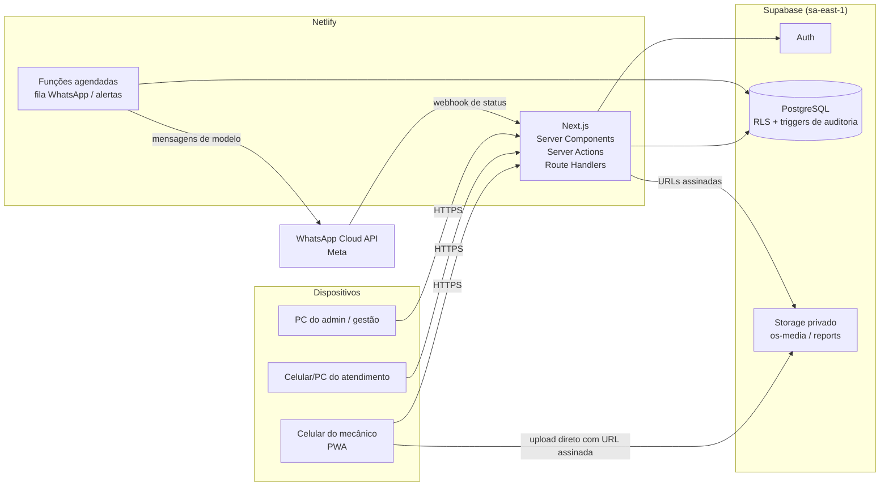
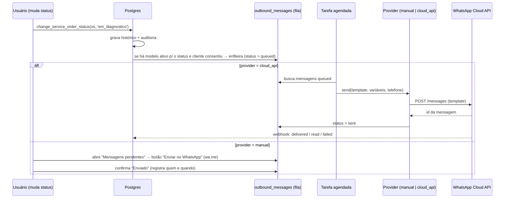

# 2. Arquitetura proposta

## 2.1 Stack

| Camada | Escolha | Por quê |
|--------|---------|---------|
| Aplicação web | **Next.js 15 (App Router) + React + TypeScript** | Frontend e backend no mesmo projeto (Server Components + Server Actions + Route Handlers). Um só deploy, um só repositório. |
| Interface | **Tailwind CSS + componentes próprios (padrão shadcn/ui, Radix)** | Rápido de manter, acessível, fácil aplicar a identidade Injecar. |
| PWA | Manifesto + service worker | Instalar na tela inicial do celular como um app, sem loja. |
| Banco | **PostgreSQL (Supabase)** | Relacional, robusto, com Row Level Security (RLS) para permissões no próprio banco. |
| Autenticação | **Supabase Auth** | Senhas com hash, sessões por cookie httpOnly, renovação de token, bloqueio de usuário. |
| Arquivos | **Supabase Storage (buckets privados)** | Fotos/vídeos nunca públicos; acesso só por URL assinada de curta duração. Políticas de acesso no mesmo modelo do banco. |
| Validação | **Zod** | Mesmo esquema valida no formulário (cliente) e na Server Action (servidor). |
| PDF | **@react-pdf/renderer** (no servidor) | Relatório gerado a partir de componentes React, sem navegador headless. |
| WhatsApp | **WhatsApp Business Platform — Cloud API (Meta)** via adaptador | Integração oficial. Enquanto não aprovada, adaptador "manual" (link oficial `wa.me`). |
| Tarefas agendadas | **Netlify Scheduled Functions** (ou `pg_cron` do Supabase) | Enviar fila de mensagens e calcular alertas. |
| Testes | **Vitest** (unidade), **testes SQL** em Postgres (RLS, triggers, regras), **Playwright** (ponta a ponta no celular emulado) | Cada módulo só avança com testes passando. |
| CI | GitHub Actions | Lint, typecheck, testes a cada push. |

**Por que Supabase e não montar backend próprio:** banco + autenticação + armazenamento + políticas de acesso num só serviço gerenciado, com backups. Evita manter servidor, fila e S3 separados no MVP. Como é Postgres puro, não há aprisionamento: o banco pode ser migrado para qualquer Postgres depois.

## 2.2 Visão geral



## 2.3 Princípios de projeto

1. **Segurança no banco, não só na tela.** Toda tabela tem RLS. Mesmo que alguém chame a API diretamente, o banco recusa o que o perfil não pode fazer. A aplicação usa a sessão do próprio usuário para consultar o banco; a chave de serviço (que ignora RLS) só é usada em tarefas internas no servidor (fila de mensagens, webhook, geração de PDF).
2. **Regras críticas em funções do banco.** Mudança de status, registro de aprovação e encerramento de OS são funções SQL transacionais (`change_service_order_status`, `record_service_item_decision`...). Garante que histórico, auditoria e fila de WhatsApp sejam gravados juntos ou nada é gravado.
3. **Histórico imutável.** Tabelas de histórico (status, aprovações, observações, auditoria) aceitam apenas inserção. Demais registros usam exclusão lógica (`deleted_at`), permitida só ao admin.
4. **Auditoria automática.** Trigger genérico grava em `audit_log` toda inserção/alteração/exclusão: tabela, registro, antes/depois, campos alterados, usuário, perfil e horário. Não depende do programador lembrar.
5. **Módulos por domínio.** O código é organizado por assunto (OS, checklist, mídia, orçamento, mensagens…), cada um com seus esquemas, ações, consultas e componentes.
6. **Integrações atrás de interfaces.** WhatsApp é um `MessagingProvider` com implementações `manual` e `cloud_api`. Trocar de provedor (ou usar um BSP no futuro) não mexe no resto.
7. **Indicadores a partir de eventos.** Como cada mudança de status é registrada com horário, todos os indicadores de tempo (diagnóstico, aprovação, por etapa, por mecânico) saem de *views* SQL sobre o histórico — a V2 de gestão é só consulta, sem refazer o modelo.

## 2.4 Estrutura de pastas

```
/
├── docs/                         # este plano
├── supabase/
│   ├── migrations/               # SQL versionado (tabelas, enums, RLS, triggers, funções, views)
│   ├── seed.sql                  # checklist inicial, modelos de mensagem, configurações
│   └── tests/                    # testes SQL de RLS, auditoria e regras de status
├── src/
│   ├── app/
│   │   ├── (auth)/login/
│   │   ├── (app)/                # área logada (layout mobile + desktop)
│   │   │   ├── patio/            # carros na oficina (home de atendimento/admin)
│   │   │   ├── meus-carros/      # home do mecânico
│   │   │   ├── os/nova/
│   │   │   ├── os/[id]/          # ficha da OS (resumo, checklist, mídia, diagnóstico, serviços, linha do tempo)
│   │   │   ├── clientes/
│   │   │   ├── veiculos/[id]/    # ficha + histórico do veículo
│   │   │   ├── mensagens/        # fila de WhatsApp
│   │   │   ├── admin/            # dashboard, usuários, checklist, modelos, alertas, auditoria, config
│   │   │   └── gestao/           # indicadores
│   │   └── api/
│   │       ├── whatsapp/webhook/ # recebe status de entrega da Meta (assinatura verificada)
│   │       ├── os/[id]/relatorio/# gera PDF
│   │       └── tarefas/          # endpoints chamados pelas funções agendadas (protegidos por segredo)
│   ├── modules/
│   │   ├── auth/  customers/  vehicles/  service-orders/  checklist/
│   │   ├── media/  diagnosis/  quotes/  messaging/  reports/  alerts/  audit/
│   │   │   └── (cada um: schema.ts, actions.ts, queries.ts, components/)
│   ├── components/ui/            # botões, cards, chips de status, bottom sheet...
│   └── lib/                      # clientes Supabase, permissões, formatação (moeda, placa, telefone)
└── tests/e2e/                    # Playwright
```

## 2.5 Segurança e LGPD

| Tema | Como será tratado |
|------|-------------------|
| Autenticação | Supabase Auth, senha mínima de 8 caracteres, sessão em cookie httpOnly/secure, logout em todos os dispositivos, usuário desativado perde acesso imediatamente (checado no RLS). |
| Autorização | Perfil (`mecanico`, `atendimento`, `admin`, `gestao`) em `profiles`; RLS em todas as tabelas; checagem repetida nas Server Actions para mensagens de erro amigáveis. Mecânico só vê as OS atribuídas a ele. |
| Validação | Zod em todas as entradas; restrições no banco (CHECK, NOT NULL, FK, únicos). Placa (padrão antigo e Mercosul), telefone (E.164 BR), CPF com dígito verificador. |
| Mídia | Buckets privados; caminho `vehicle/{veiculo}/os/{os}/{uuid}`; upload por URL assinada emitida pelo servidor só para quem pode editar a OS; leitura por URL assinada de 10 minutos; tipos permitidos (jpeg/png/webp/heic, mp4/quicktime/webm) e limite de tamanho. |
| Auditoria | `audit_log` via trigger, só inserção, visível apenas ao admin. |
| Proteção de dados pessoais | Coleta mínima (CPF opcional); consentimento de WhatsApp registrado; função de **anonimização** do cliente (atende pedido de eliminação mantendo o histórico técnico do veículo); exportação dos dados de um cliente (direito de acesso); banco e arquivos no Brasil; criptografia em repouso e em trânsito (Supabase/TLS); backups diários. |
| Cabeçalhos e boas práticas | CSP, `X-Frame-Options`, `Referrer-Policy`, cookies `SameSite`, proteção CSRF nativa das Server Actions, limitação de tentativas de login, segredos só em variáveis de ambiente, webhook da Meta com verificação de assinatura `X-Hub-Signature-256`. |
| Logs | Sem dados pessoais em logs de aplicação. |

## 2.6 WhatsApp — desenho da integração



- **Fila (outbox)** garante que a mensagem não se perde se a Meta estiver fora e permite reenvio, cancelamento e auditoria.
- **Modelos** (`message_templates`) ligados a um status-gatilho, com variáveis `{nome}`, `{modelo}`, `{placa}`, `{numero_os}`, `{oficina}`. Para a API, cada modelo guarda `meta_template_name` e o idioma (`pt_BR`), e as variáveis são mapeadas para `{{1}}`, `{{2}}`…
- **Respostas do cliente** (inbox) ficam para a V2; o webhook já grava todos os eventos brutos para não perder nada.
- **Aprovação por link (V2):** a tabela de aprovações já tem o método `link`; na V2 entra uma página pública com token aleatório, de uso único e com validade, que mostra só o orçamento daquela OS.
