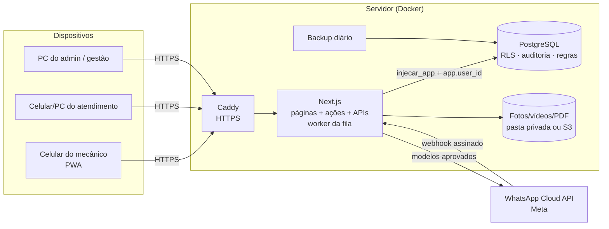
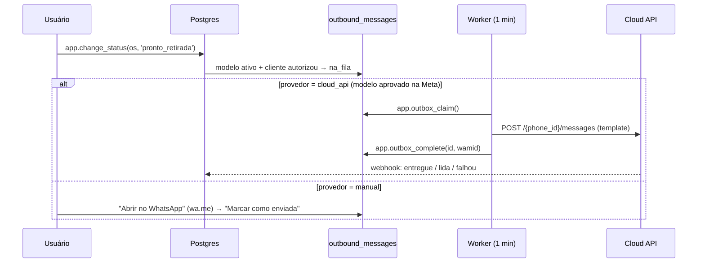

# 2. Arquitetura (como foi implementada)

> Revisão após a decisão de **não usar Netlify**: o sistema roda em qualquer servidor com Docker
> (VPS) ou em serviços gerenciados. Nada depende de um fornecedor específico.

## 2.1 Stack

| Camada | Escolha | Por quê |
|--------|---------|---------|
| Aplicação web | **Next.js 15 (App Router) + React 19 + TypeScript** | Frontend e backend no mesmo projeto (Server Components, Server Actions, Route Handlers). Um deploy, um repositório. |
| Interface | **Tailwind CSS 4 + componentes próprios** | Identidade Injecar (vermelho `#c80000`, preto `#0d0d0d`, branco), botões de 56 px, mobile-first. |
| PWA | Manifesto + service worker | Instala na tela inicial do celular; página “sem conexão”. Não guarda dados de clientes em cache. |
| Banco | **PostgreSQL 15+** | Pode ser o do próprio servidor (Docker), o do Supabase, Neon, RDS… — é Postgres puro. |
| Autenticação | **Própria, no servidor** | Usuário + senha (mecânico não precisa de e-mail), hash **scrypt**, sessão em cookie httpOnly com token aleatório guardado como hash no banco, bloqueio após 5 tentativas, desativação imediata. |
| Permissões | **Row Level Security no Postgres** | A aplicação conecta como `injecar_app` (sem bypass de RLS). Cada transação informa o usuário (`app.user_id`); o banco decide o que ele pode ver/alterar. |
| Arquivos | **Armazenamento privado: pasta local ou S3 compatível** | AWS S3, Cloudflare R2, Supabase Storage (S3), MinIO. Nunca público: toda foto passa por `/api/media/:id`, que confere sessão e permissão a cada acesso. |
| Validação | **Zod** + restrições no banco | Mesma regra no formulário e no servidor; o banco tem CHECK/FK/únicos como última barreira. |
| PDF | **@react-pdf/renderer** no servidor | Relatório gerado sem navegador; versões guardadas no armazenamento privado. |
| WhatsApp | **WhatsApp Business Platform — Cloud API (Meta)** | Fila de mensagens no banco; modo manual oficial (`wa.me`) até a Meta aprovar os modelos. |
| Tarefas | Worker interno (a cada 1 min) ou cron externo em `/api/tasks/outbox` | Processa a fila de mensagens da API. Alertas são calculados em tempo real por view. |
| Testes | **Vitest** (unidade + banco real) e **Playwright** (ponta a ponta no celular) | 57 testes de unidade/banco + 13 cenários de ponta a ponta. |
| Implantação | **Docker Compose**: app + Postgres + Caddy (HTTPS automático) + backup diário | Um comando sobe tudo num VPS. Veja [08-implantacao.md](08-implantacao.md). |

### Por que trocamos Supabase Auth por autenticação própria

- Mecânicos entram com **usuário** (ex.: `joao`), sem e-mail.
- Com autenticação no próprio servidor, **a regra de acesso fica toda no Postgres** (RLS) e o sistema roda em qualquer hospedagem.
- O Supabase continua sendo uma ótima opção para **hospedar o banco e as fotos** (Postgres + Storage S3): basta apontar as variáveis de ambiente. As migrações já bloqueiam a API automática do Supabase (`anon`/`authenticated`).

## 2.2 Visão geral



## 2.3 Princípios aplicados

1. **Segurança no banco, não só na tela.** Todas as tabelas com RLS; a aplicação não é dona das tabelas e só recebe permissão nas colunas que pode alterar. Exemplo: ninguém consegue `UPDATE service_orders SET status = …` — só pela função `app.change_status`, que valida perfil e transição.
2. **Regras críticas em funções transacionais.** Abrir OS, mudar etapa, registrar aprovação, executar serviço, anonimizar cliente: histórico, auditoria e fila de WhatsApp gravados juntos.
3. **Histórico imutável.** Linha do tempo, decisões do cliente, observações e auditoria só aceitam inserção. A aplicação não tem permissão de `DELETE` em nenhuma tabela; remoções são lógicas (com motivo) e só do admin.
4. **Auditoria automática.** Trigger em todas as tabelas de negócio grava antes/depois, campos alterados, usuário, perfil, data/hora e a OS relacionada.
5. **Autoria à prova de falsificação.** `created_by`, `updated_by`, `uploaded_by`, `changed_by`… são preenchidos pelo banco a partir da sessão.
6. **Indicadores a partir de eventos.** Tempos por etapa, alertas e KPIs saem de *views* sobre o histórico (`v_status_durations`, `v_alerts`, `v_kpi_orders`).

## 2.4 Estrutura de pastas

```
db/migrations/            SQL versionado (tabelas, RLS, triggers, funções, views, dados iniciais)
scripts/                  migrate.ts · create-admin.ts · demo-data.ts
src/app/login/            tela de login
src/app/(app)/            área logada
  meus-carros/  patio/  os/nova/  os/[id]/(resumo|checklist|fotos|diagnostico|servicos|historico|mensagens|relatorio)
  clientes/  veiculos/  buscar/  mensagens/  gestao/  perfil/
  admin/ (dashboard, usuarios, checklist, mensagens, alertas, empresa, auditoria, lgpd, config)
src/app/api/              media (upload/entrega), relatorio (PDF), whatsapp/webhook, tasks/outbox, health, admin/lgpd/export
src/lib/                  db, auth, storage, whatsapp, report (PDF), validation, format, status, roles
src/components/           UI, formulários, câmera/upload, barra de etapas, cartões
tests/unit · tests/db · tests/e2e
deploy/                   Caddyfile, exemplo de .env de produção
```

## 2.5 Segurança e LGPD

| Tema | Implementação |
|------|---------------|
| Senhas | scrypt (N=2¹⁶) com sal; troca obrigatória no primeiro acesso; mínimo 8 caracteres com letras e números. |
| Sessão | Token de 256 bits em cookie `httpOnly`, `SameSite=Lax`, `Secure` em HTTPS; no banco só o hash SHA-256; 30 dias; trocar senha/desativar derruba as outras sessões. |
| Força bruta | 5 falhas em 15 min bloqueiam o usuário; limite também por IP. Tempo de resposta igual para usuário inexistente. |
| Autorização | RLS + grants por coluna + funções que checam perfil; checagem repetida nas páginas para redirecionar. |
| Mecânico | Vê só as OS dele (e o histórico dos carros que estão com ele). Não vê CPF, telefone nem valores. Não exclui nada. |
| Mídia | Tipo real conferido pelos bytes (não pela extensão); limite 100 MB; arquivos com permissão 600; entrega só após checar permissão; suporte a Range para vídeo. |
| Cabeçalhos | CSP restritiva, `X-Frame-Options: DENY`, `nosniff`, `Referrer-Policy`, HSTS, `Permissions-Policy`. |
| Webhook Meta | Assinatura `X-Hub-Signature-256` verificada com tempo constante; token de verificação. |
| LGPD | Coleta mínima (CPF opcional); consentimento de WhatsApp com data e responsável; exportação dos dados do titular; anonimização que também limpa a auditoria e as mensagens; nada de dados pessoais em logs; robots bloqueados. |

## 2.6 WhatsApp — fluxo



Detalhes de configuração da Meta em [09-whatsapp.md](09-whatsapp.md).
