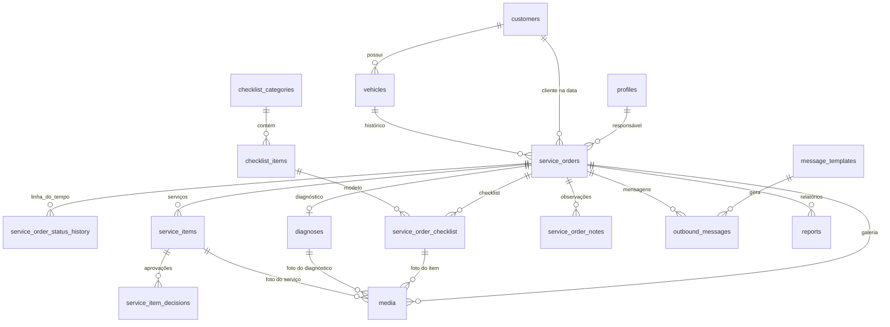

# 3. Estrutura do banco de dados

PostgreSQL 15+ (Supabase). Convenções:

- Chaves primárias `uuid` (`gen_random_uuid()`), exceto `audit_log` (`bigint` sequencial).
- Valores em dinheiro em **centavos** (`bigint`) — sem erro de arredondamento.
- Datas `timestamptz` (gravadas em UTC, exibidas em `America/Belem`).
- Toda tabela de negócio tem `created_at`, `created_by`, `updated_at`, `updated_by` (preenchidos por trigger a partir do usuário logado — o cliente não consegue falsificar).
- Exclusão lógica (`deleted_at`, `deleted_by`) onde houver exclusão; tabelas de histórico são só inserção.

## 3.1 Diagrama



## 3.2 Tipos enumerados

```sql
create type user_role as enum ('mecanico', 'atendimento', 'admin', 'gestao');

create type fuel_type as enum ('gasolina', 'etanol', 'flex', 'diesel', 'gnv', 'hibrido', 'eletrico', 'outro');

create type os_status as enum (
  'recebido',               -- 1  Veículo recebido
  'em_inspecao',            -- 2  Em inspeção
  'em_diagnostico',         -- 3  Em diagnóstico
  'diagnostico_concluido',  -- 4  Diagnóstico concluído
  'orcamento_em_preparacao',-- 5  Orçamento em preparação
  'aguardando_aprovacao',   -- 6  Aguardando aprovação do cliente
  'servico_aprovado',       -- 7  Serviço aprovado
  'em_manutencao',          -- 8  Em manutenção
  'aguardando_peca',        -- 9  Aguardando peça
  'em_teste',               -- 10 Em teste
  'servico_concluido',      -- 11 Serviço concluído
  'pronto_retirada',        -- 12 Pronto para retirada
  'entregue',               -- 13 Entregue
  'cancelada'               --    OS cancelada (desistência) — só atendimento/admin, com motivo
);

create type checklist_result as enum ('ok', 'atencao', 'necessita_reparo', 'nao_avaliado');
create type media_kind       as enum ('foto', 'video');
create type service_priority as enum ('urgente', 'recomendado', 'pode_acompanhar');
create type approval_status  as enum ('pendente', 'aprovado', 'recusado');
create type approval_method  as enum ('presencial', 'telefone', 'whatsapp', 'link');
create type execution_status as enum ('nao_iniciado', 'em_execucao', 'executado', 'nao_executado');
create type message_provider as enum ('manual', 'cloud_api');
create type message_status   as enum ('na_fila', 'enviando', 'enviada', 'entregue', 'lida', 'falhou', 'cancelada');
```

## 3.3 Tabelas

### Pessoas e acesso

```sql
-- 1:1 com auth.users (Supabase Auth)
create table profiles (
  id          uuid primary key references auth.users(id),
  full_name   text not null,
  username    text not null unique check (username ~ '^[a-z0-9._-]{3,30}$'),
  role        user_role not null,
  phone       text,
  active      boolean not null default true,
  created_at  timestamptz not null default now(),
  updated_at  timestamptz not null default now()
);

create table customers (
  id                  uuid primary key default gen_random_uuid(),
  name                text not null check (length(trim(name)) >= 2),
  phone               text,                       -- E.164: +5591...
  whatsapp            text,                       -- E.164
  cpf                 text unique,                -- opcional, só dígitos, validado
  notes               text,
  whatsapp_opt_in     boolean not null default false,
  whatsapp_opt_in_at  timestamptz,
  whatsapp_opt_in_by  uuid references profiles(id),
  anonymized_at       timestamptz,                -- LGPD: dados pessoais removidos
  created_at, created_by, updated_at, updated_by  -- padrão
);

create table vehicles (
  id           uuid primary key default gen_random_uuid(),
  customer_id  uuid not null references customers(id),  -- proprietário atual
  plate        text not null unique check (plate ~ '^[A-Z]{3}[0-9][A-Z0-9][0-9]{2}$'), -- antiga e Mercosul, normalizada
  brand        text not null,
  model        text not null,
  version      text,
  year         smallint check (year between 1950 and 2100),
  engine       text,
  fuel         fuel_type,
  current_km   integer check (current_km >= 0),       -- atualizada na abertura de cada OS
  color        text,
  notes        text,
  created_at, created_by, updated_at, updated_by
);
```

### Ordem de serviço

```sql
create table service_orders (
  id                    uuid primary key default gen_random_uuid(),
  number                integer not null unique generated always as identity, -- exibido como OS 0001
  vehicle_id            uuid not null references vehicles(id),
  customer_id           uuid not null references customers(id),   -- cliente NA DATA (carro pode mudar de dono)
  entry_km              integer not null check (entry_km >= 0),
  entry_at              timestamptz not null default now(),
  assigned_mechanic_id  uuid references profiles(id),
  complaint             text not null,          -- reclamação do cliente
  intake_notes          text,                   -- observações do atendimento
  status                os_status not null default 'recebido',
  status_changed_at     timestamptz not null default now(),
  last_activity_at      timestamptz not null default now(), -- atualizado por qualquer registro na OS (alerta "sem atualização")
  final_notes           text,
  completed_at          timestamptz,            -- entrou em servico_concluido
  delivered_at          timestamptz,
  cancelled_reason      text,
  created_at, created_by, updated_at, updated_by
);

-- Linha do tempo: SÓ INSERÇÃO
create table service_order_status_history (
  id                uuid primary key default gen_random_uuid(),
  service_order_id  uuid not null references service_orders(id),
  from_status       os_status,
  to_status         os_status not null,
  note              text,
  changed_by        uuid not null references profiles(id),
  changed_at        timestamptz not null default now()
);

-- Observações livres (mecânico/atendimento): SÓ INSERÇÃO
create table service_order_notes (
  id                uuid primary key default gen_random_uuid(),
  service_order_id  uuid not null references service_orders(id),
  body              text not null,
  author_id         uuid not null references profiles(id),
  created_at        timestamptz not null default now()
);
```

### Checklist personalizável

```sql
-- Modelo (o admin edita sem mexer no código)
create table checklist_categories (
  id        uuid primary key default gen_random_uuid(),
  name      text not null unique,
  position  integer not null,
  active    boolean not null default true,
  created_at, created_by, updated_at, updated_by
);

create table checklist_items (
  id           uuid primary key default gen_random_uuid(),
  category_id  uuid not null references checklist_categories(id),
  name         text not null,
  position     integer not null,
  active       boolean not null default true,
  unique (category_id, name),
  created_at, created_by, updated_at, updated_by
);

-- Checklist preenchido de cada OS.
-- Guarda CÓPIA do nome da categoria/item: se o admin renomear ou desativar um item,
-- o histórico das OS antigas continua exatamente como foi preenchido.
create table service_order_checklist (
  id                 uuid primary key default gen_random_uuid(),
  service_order_id   uuid not null references service_orders(id),
  checklist_item_id  uuid references checklist_items(id),
  category_name      text not null,
  item_name          text not null,
  position           integer not null,
  result             checklist_result not null default 'nao_avaliado',
  note               text,
  unique (service_order_id, checklist_item_id),
  created_at, created_by, updated_at, updated_by
);
```

Ao abrir a OS, os itens ativos do modelo são copiados para `service_order_checklist`.

### Diagnóstico

```sql
create table diagnoses (
  id                 uuid primary key default gen_random_uuid(),
  service_order_id   uuid not null unique references service_orders(id),
  reported_symptom   text,
  tests_performed    text,
  results            text,
  root_cause         text,
  components         text,
  recommendation     text,
  technical_notes    text,
  completed_at       timestamptz,
  created_at, created_by, updated_at, updated_by
);
```

Cada edição fica registrada na auditoria (antes/depois), então o texto anterior nunca se perde.

### Serviços, orçamento, aprovação e execução

```sql
create table service_items (
  id                     uuid primary key default gen_random_uuid(),
  service_order_id       uuid not null references service_orders(id),
  title                  text not null,              -- serviço
  description            text,
  part_name              text,                       -- peça
  quantity               numeric(10,2) not null default 1 check (quantity > 0),
  part_unit_price_cents  bigint not null default 0 check (part_unit_price_cents >= 0),
  labor_price_cents      bigint not null default 0 check (labor_price_cents >= 0),
  priority               service_priority not null default 'recomendado',
  -- estado atual da aprovação (o histórico completo fica em service_item_decisions)
  approval_status        approval_status not null default 'pendente',
  -- execução
  execution_status       execution_status not null default 'nao_iniciado',
  executed_by            uuid references profiles(id),
  executed_at            timestamptz,
  execution_notes        text,
  deleted_at             timestamptz,                -- só antes de aprovado, só atendimento/admin
  deleted_by             uuid references profiles(id),
  created_at, created_by, updated_at, updated_by
);

-- Cada decisão do cliente: SÓ INSERÇÃO (se ele mudar de ideia, fica a nova linha e a antiga)
create table service_item_decisions (
  id               uuid primary key default gen_random_uuid(),
  service_item_id  uuid not null references service_items(id),
  decision         approval_status not null check (decision <> 'pendente'),
  method           approval_method not null,
  customer_note    text,
  -- valores no momento da aprovação (prova do que o cliente aprovou)
  approved_total_cents bigint not null,
  recorded_by      uuid not null references profiles(id),
  decided_at       timestamptz not null default now()
);
```

### Mídia

```sql
create table media (
  id                  uuid primary key default gen_random_uuid(),
  vehicle_id          uuid not null references vehicles(id),
  service_order_id    uuid not null references service_orders(id),
  checklist_entry_id  uuid references service_order_checklist(id),
  diagnosis_id        uuid references diagnoses(id),
  service_item_id     uuid references service_items(id),
  kind                media_kind not null,
  storage_path        text not null unique,   -- bucket privado os-media
  thumb_path          text,                   -- miniatura gerada no celular
  mime_type           text not null,
  size_bytes          bigint not null check (size_bytes <= 104857600),
  duration_seconds    integer,
  caption             text,
  include_in_report   boolean not null default false,  -- "foto relevante" para o PDF
  uploaded_by         uuid not null references profiles(id),
  created_at          timestamptz not null default now(),
  deleted_at          timestamptz,            -- só admin, com motivo
  deleted_by          uuid references profiles(id),
  deleted_reason      text
);
```

### Mensagens (WhatsApp)

```sql
create table message_templates (
  id                  uuid primary key default gen_random_uuid(),
  trigger_status      os_status unique,          -- dispara ao entrar neste status (null = uso manual)
  name                text not null,
  body                text not null,             -- "Olá, {nome}. Seu {modelo} foi recebido..."
  meta_template_name  text,                      -- nome do modelo aprovado na Meta
  meta_language       text not null default 'pt_BR',
  active              boolean not null default true,
  created_at, created_by, updated_at, updated_by
);

create table outbound_messages (
  id                   uuid primary key default gen_random_uuid(),
  service_order_id     uuid references service_orders(id),
  customer_id          uuid not null references customers(id),
  template_id          uuid references message_templates(id),
  to_phone             text not null,
  rendered_body        text not null,
  variables            jsonb not null default '{}',
  provider             message_provider not null,
  status               message_status not null default 'na_fila',
  provider_message_id  text unique,
  attempts             integer not null default 0,
  last_error           text,
  sent_at              timestamptz,
  sent_by              uuid references profiles(id),   -- no modo manual: quem enviou
  delivered_at         timestamptz,
  read_at              timestamptz,
  created_at           timestamptz not null default now(),
  created_by           uuid references profiles(id)
);

-- Eventos brutos recebidos da Meta (auditoria/depuração)
create table whatsapp_webhook_events (
  id           bigint generated always as identity primary key,
  payload      jsonb not null,
  received_at  timestamptz not null default now()
);
```

### Relatórios, configurações e auditoria

```sql
create table reports (
  id                uuid primary key default gen_random_uuid(),
  service_order_id  uuid not null references service_orders(id),
  storage_path      text not null,          -- bucket privado reports
  version           integer not null,
  generated_by      uuid not null references profiles(id),
  generated_at      timestamptz not null default now(),
  unique (service_order_id, version)
);

-- Chave/valor tipado: limites de alertas, dados da empresa, provedor de WhatsApp...
create table settings (
  key         text primary key,
  value       jsonb not null,
  updated_at  timestamptz not null default now(),
  updated_by  uuid references profiles(id)
);
-- ex.: alert.no_update_hours = 4
--      alert.diagnosis_max_hours = 24
--      alert.approval_max_hours = 24
--      alert.waiting_part_max_hours = 72
--      alert.ready_not_notified_minutes = 30
--      messaging.provider = "manual"
--      company = { "name": "Injecar Auto Center", "cnpj": "...", "address": "...", "phone": "..." }

-- Auditoria: SÓ INSERÇÃO, preenchida por trigger em todas as tabelas de negócio
create table audit_log (
  id              bigint generated always as identity primary key,
  table_name      text not null,
  record_id       uuid,
  action          text not null check (action in ('INSERT','UPDATE','DELETE')),
  old_data        jsonb,
  new_data        jsonb,
  changed_fields  text[],
  actor_id        uuid,              -- auth.uid()
  actor_role      user_role,
  occurred_at     timestamptz not null default now()
);
```

## 3.4 Funções de regra de negócio (transacionais)

| Função | Faz |
|--------|-----|
| `open_service_order(...)` | Cria a OS, atualiza km do veículo, copia o checklist ativo, grava status `recebido` no histórico e enfileira a mensagem "Veículo recebido" (se houver consentimento). |
| `change_service_order_status(os_id, to_status, note)` | Valida perfil × transição permitida, exige observação quando volta etapa/cancela, grava histórico, atualiza datas (`completed_at`, `delivered_at`), enfileira mensagem do status. |
| `record_service_item_decision(item_id, decision, method, note)` | Grava decisão com o valor do momento, atualiza `approval_status`; se não há mais itens pendentes, sugere avançar para "Serviço aprovado". |
| `touch_service_order()` (trigger) | Atualiza `last_activity_at` sempre que algo da OS é registrado. |
| `anonymize_customer(customer_id)` | LGPD: substitui nome/telefones/CPF por marcadores, mantém o histórico técnico do veículo, registra na auditoria. Só admin. |

## 3.5 Views (dashboards e indicadores)

| View | Uso |
|------|-----|
| `v_service_order_totals` | Total de peças, mão de obra, aprovado, recusado e executado por OS. |
| `v_status_durations` | Para cada passagem de status: entrada, saída e duração (função de janela `lead()` sobre o histórico). Base de "tempo em cada etapa". |
| `v_yard` | Carros na oficina (status ≠ entregue/cancelada) com cliente, veículo, mecânico, status, tempo na etapa atual, horas sem atualização. |
| `v_alerts` | Alertas calculados com os limites de `settings`: sem atualização há X h, aguardando aprovação acima do limite, pronto sem cliente notificado, aguardando peça acima do limite, diagnóstico acima do limite. |
| `v_kpi_*` (V2, já preparadas pelo modelo) | Carros atendidos, tempo médio de diagnóstico (`em_diagnostico` → `diagnostico_concluido`), tempo médio de aprovação (`aguardando_aprovacao` → `servico_aprovado`), produtividade por mecânico, serviços aprovados/recusados, faturamento por OS, ticket médio. |

## 3.6 Permissões (RLS) — resumo

| Recurso | Mecânico | Atendimento | Admin | Gestão |
|---------|----------|-------------|-------|--------|
| Clientes | ler nome/modelo das OS dele (sem CPF/telefone) | ler, criar, editar | tudo | ler |
| Veículos | ler os das OS dele (+ histórico do veículo) | ler, criar, editar | tudo | ler |
| OS | ler/editar as atribuídas a ele | ler todas, criar, editar | tudo | ler |
| Status | etapas técnicas (2, 3, 4, 8, 9, 10, 11) | etapas de atendimento (1, 5, 6, 7, 12, 13, cancelar) + voltar etapa | tudo | — |
| Checklist / diagnóstico / observações | criar e editar nas OS dele | ler, criar, editar | tudo | ler |
| Mídia | enviar nas OS dele; **não apaga** | enviar, marcar p/ relatório | tudo, inclusive exclusão lógica | ler |
| Serviços | criar sem preço, registrar execução | criar, precificar, registrar aprovação | tudo | ler |
| Histórico de status, decisões, observações, auditoria | só inserção via funções; ninguém altera ou apaga | idem | idem (auditoria: leitura) | leitura |
| Modelos de checklist, mensagens, configurações, usuários | — | ler | tudo | ler |

O mecânico **não tem permissão de DELETE em nenhuma tabela**.
