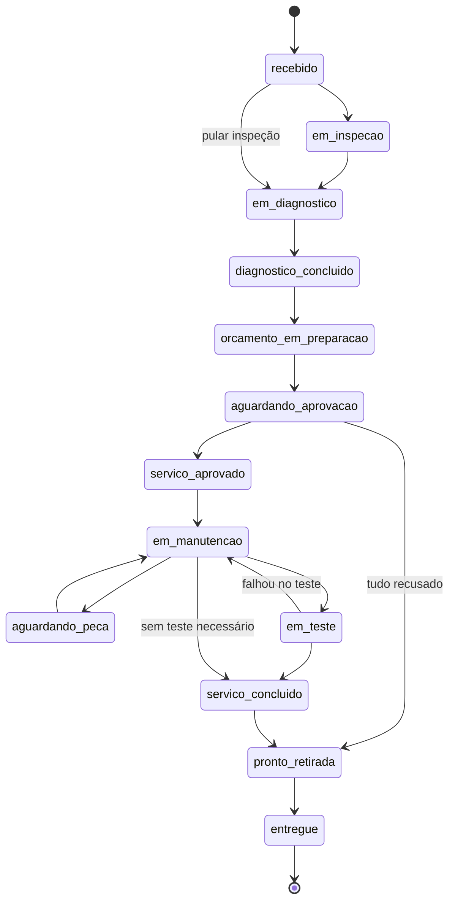

# 5. Fluxo completo: da chegada à entrega

## 5.1 Passo a passo

| # | Etapa | Quem | O que acontece no sistema | Mensagem ao cliente* |
|---|-------|------|---------------------------|----------------------|
| 1 | **Chegada** | Atendimento | Busca pela placa. Se o carro já veio antes, o sistema mostra cliente, veículo e o último atendimento (incluindo recomendações "pode acompanhar" pendentes — oportunidade de venda). Senão, cadastra cliente e veículo. Registra consentimento de WhatsApp. | — |
| 2 | **Abertura da OS** | Atendimento | Km de entrada, reclamação, observações, mecânico. Data/hora automáticas. Checklist copiado do modelo. Status **1 Recebido**. | "Veículo recebido" |
| 3 | **Inspeção** | Mecânico | O carro aparece em "Meus carros". Ele abre e toca em "Iniciar inspeção" → **2 Em inspeção**. Preenche o checklist item a item com fotos/vídeos/notas. | — |
| 4 | **Diagnóstico** | Mecânico | "Iniciar diagnóstico" → **3 Em diagnóstico**. Preenche a área de diagnóstico (sintoma, testes, resultados, causa, componentes, recomendação). Cadastra os serviços recomendados (serviço, peça, quantidade, prioridade — sem preço). "Concluir diagnóstico" → **4 Diagnóstico concluído**. | "Em diagnóstico" |
| 5 | **Orçamento** | Atendimento | Recebe o alerta/indicação de diagnóstico concluído. Abre o orçamento → **5 Orçamento em preparação**. Coloca preço de peça e mão de obra por item; o sistema soma tudo. | — |
| 6 | **Envio ao cliente** | Atendimento | "Enviar ao cliente" → **6 Aguardando aprovação**. A mensagem vai pela fila de WhatsApp. O atendimento conversa com o cliente (WhatsApp/telefone/presencial). | "Aguardando aprovação" |
| 7 | **Aprovação** | Atendimento | Registra por item: aprovado/recusado + forma + observação. O valor aprovado fica congelado no registro. Com nada pendente → **7 Serviço aprovado**. Se tudo for recusado, a OS segue direto para **12 Pronto para retirada** (devolução sem serviço). | — |
| 8 | **Manutenção** | Mecânico | "Iniciar serviços" → **8 Em manutenção**. Marca cada serviço aprovado como executado (quem e quando ficam registrados), com fotos do antes/depois. Se faltar peça → **9 Aguardando peça** (e volta para 8 quando chegar). Se encontrar algo novo: adiciona serviço → fica pendente → atendimento registra nova aprovação. | "Serviço iniciado" |
| 9 | **Teste** | Mecânico | **10 Em teste** (rodagem/verificação final). Depois "Concluir minha parte" → **11 Serviço concluído**. | — |
| 10 | **Liberação** | Atendimento | Confere serviços executados × aprovados, marca as fotos que vão no relatório, gera o **PDF**. → **12 Pronto para retirada**. | "Pronto" |
| 11 | **Entrega** | Atendimento | Cliente retira. "Registrar entrega" → **13 Entregue**. A OS fica encerrada e passa a fazer parte do histórico do veículo. Relatório disponível para reenviar a qualquer momento. | (opcional: agradecimento) |

\* Somente se o modelo de mensagem do status estiver ativo e o cliente tiver consentido.

## 5.2 Máquina de estados

Regras adicionais:

- **Voltar etapa:** atendimento/admin podem voltar para qualquer etapa anterior com observação obrigatória (ex.: cliente pediu nova avaliação).
- **Cancelar:** atendimento/admin, de qualquer etapa antes de "Entregue", com motivo obrigatório. Cancelada → só pode ser "Entregue" (devolução do carro).
- **Quem move o quê:** mecânico nas etapas técnicas (2, 3, 4, 8, 9, 10, 11); atendimento nas comerciais e de entrega (1, 5, 6, 7, 12, 13); admin em todas.
- **Bloqueios:** não dá para ir para "Aguardando aprovação" sem ao menos um serviço; nem para "Serviço aprovado" com item pendente; nem para "Entregue" sem passar por "Pronto para retirada" (exceto admin).
- Toda transição grava: status anterior, novo status, usuário, data/hora, observação.

## 5.3 Alertas internos (MVP: no dashboard e no pátio; V2: notificação push)

| Alerta | Regra (limites editáveis pelo admin) |
|--------|--------------------------------------|
| Sem atualização | Nenhum registro na OS há mais de **X h** (padrão 4 h, só em horário de funcionamento na V2) |
| Orçamento aguardando aprovação | Em "Aguardando aprovação" há mais de **X h** (padrão 24 h) |
| Pronto sem cliente notificado | Em "Pronto para retirada" e a mensagem do status não foi enviada em **X min** (padrão 30) |
| Parado aguardando peça | Em "Aguardando peça" há mais de **X h** (padrão 72 h) |
| Diagnóstico demorado | Em "Em diagnóstico" há mais de **X h** (padrão 24 h) |
